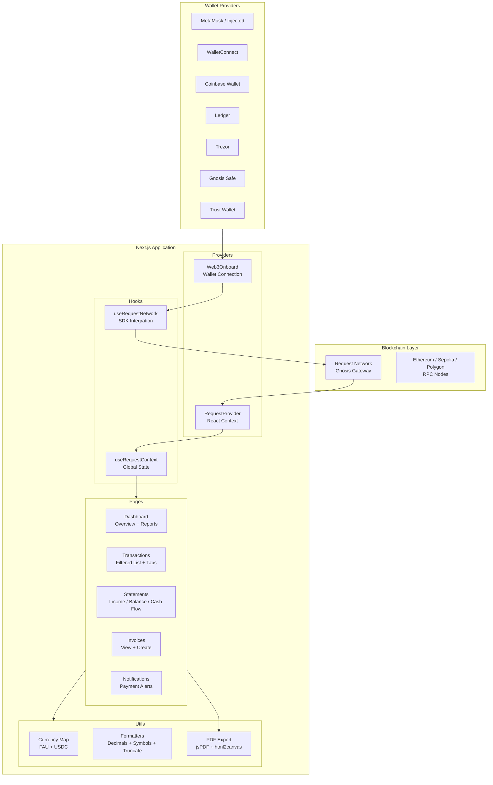
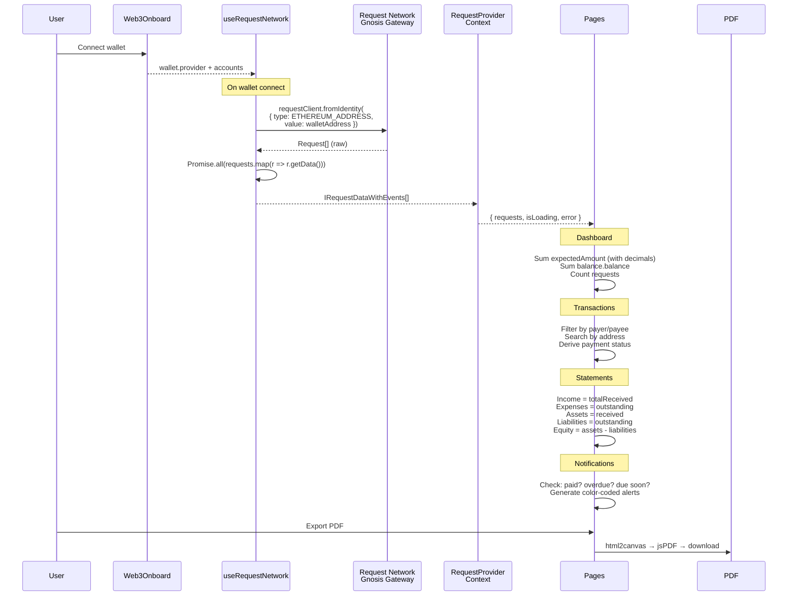
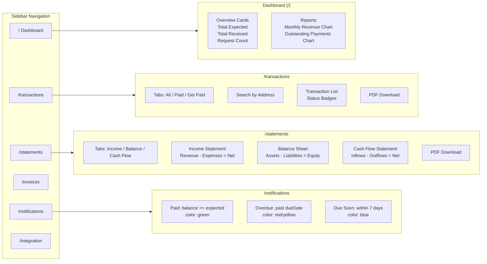
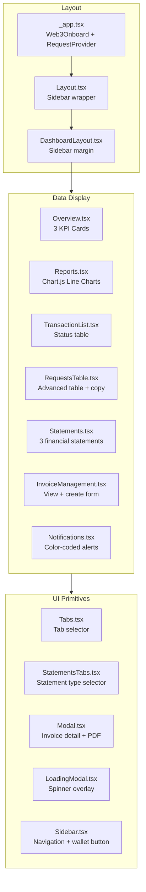

# System Design — Request Accounting

Decentralized accounting dashboard built on Request Network. Reads blockchain-based payment requests and renders financial views — transactions, statements, reports, notifications — with PDF export.

---

## High-Level Architecture



---

## Data Flow



---

## Application Pages



---

## Financial Calculations

```mermaid
graph TD
    subgraph Input ["Raw Request Data"]
        EA[expectedAmount<br/>BigInt per request]
        BAL[balance.balance<br/>Amount received]
        TS[timestamp<br/>Unix seconds]
        CI[currencyInfo<br/>network + token address]
    end

    subgraph Transform ["Transformations"]
        DEC[getDecimals(network, tokenAddr)<br/>Currency map lookup]
        FMT2["formatUnits(BigInt, decimals)<br/>Human-readable amount"]
    end

    subgraph Aggregations
        TE["totalExpected = Σ formatUnits(expectedAmount)"]
        TR2["totalReceived = Σ balance.balance"]
        OUT["outstanding = totalExpected - totalReceived"]
    end

    subgraph Statements2 ["Financial Statements"]
        IS2["Income Statement<br/>Income: totalReceived<br/>Expenses: outstanding<br/>Net: income - expenses"]
        BS2["Balance Sheet<br/>Assets: totalReceived<br/>Liabilities: outstanding<br/>Equity: assets - liabilities"]
        CF2["Cash Flow<br/>Inflows: totalReceived<br/>Outflows: outstanding<br/>Net: inflows - outflows"]
    end

    subgraph Charts ["Monthly Reports"]
        MR["Monthly Revenue<br/>Group received by month<br/>Line chart (12 months)"]
        MP["Outstanding Payments<br/>Group outstanding by month<br/>Line chart (12 months)"]
    end

    EA --> DEC --> FMT2 --> TE
    BAL --> TR2
    TE & TR2 --> OUT
    TE & TR2 & OUT --> Statements2
    TE & TR2 --> Charts
```

---

## Component Architecture



---

## Wallet Integration

```mermaid
graph LR
    subgraph Supported ["7 Wallet Providers"]
        INJ[Injected<br/>MetaMask etc.]
        WC2[WalletConnect v2]
        CB2[Coinbase]
        LED2[Ledger]
        TR2b[Trezor]
        GS2[Gnosis Safe]
        TW2[Trust Wallet]
    end

    subgraph Networks ["3 Supported Networks"]
        ETH2["Ethereum Mainnet<br/>Chain 0x1"]
        SEP["Sepolia Testnet<br/>Chain 0xaa36a7"]
        POL["Polygon<br/>Chain 0x89"]
    end

    subgraph Flow ["Connection Flow"]
        W3O2[Web3Onboard<br/>Unified connector]
        ACC[Get wallet address]
        RN2[Request Network<br/>fromIdentity(address)]
        DATA[Fetch all requests<br/>for this wallet]
    end

    Supported --> W3O2
    Networks --> W3O2
    W3O2 --> ACC --> RN2 --> DATA
```

---

## Design Decisions

| Decision | Chosen | Alternative | Reasoning |
|----------|--------|-------------|-----------|
| **Framework** | Next.js 14 (Pages Router) | App Router / SPA | Pages Router is simpler for dashboard apps, no need for server components |
| **State management** | React Context | Redux / Zustand | Single data source (Request Network), no complex state transitions |
| **Wallet connection** | Web3Onboard | RainbowKit / wagmi | Supports 7+ wallet providers out of the box, including hardware wallets |
| **Data source** | Request Network SDK | Custom API / The Graph | Request Network IS the data — no intermediary needed |
| **No backend** | Read-only from blockchain | Express API / database | All data lives on-chain via Request Network, nothing to store server-side |
| **Charts** | Chart.js (react-chartjs-2) | Recharts / D3 | Lightweight, good defaults for line charts |
| **PDF export** | html2canvas + jsPDF | Server-side PDF / Puppeteer | Client-side generation, no server needed |
| **Styling** | Tailwind CSS | CSS Modules / styled-components | Rapid prototyping, utility-first |
| **BigInt handling** | viem formatUnits | ethers.utils.formatUnits | viem is lighter, same functionality for unit conversion |

### What Would Change at Scale

| Current | At Scale | Why |
|---------|----------|-----|
| Client-side only | Backend API with caching | Request Network queries are slow for large request sets |
| Context for state | React Query / SWR | Automatic caching, refetching, stale data handling |
| No persistence | PostgreSQL for indexed data | Search, filter, sort across thousands of requests efficiently |
| html2canvas PDF | Server-side PDF generation | Higher quality, supports pagination, handles large datasets |
| No auth beyond wallet | Session tokens + SIWE | Sign-In with Ethereum for persistent sessions |
| Single-tenant | Multi-org with role-based access | Accounting teams need shared access with permissions |

### Known Limitations

1. **No backend**: All data fetched client-side from Request Network on every page load
2. **No caching**: Request Network queries re-run on every wallet connect
3. **Invoice creation incomplete**: Form UI exists but no on-chain creation logic
4. **No pagination**: All requests loaded at once — slow for wallets with many requests
5. **Limited currency support**: Only FAU and USDC on Sepolia configured
6. **No test coverage**: No unit or integration tests
7. **Financial calculations are simplified**: Income statement treats outstanding as expenses, which is an accounting simplification
